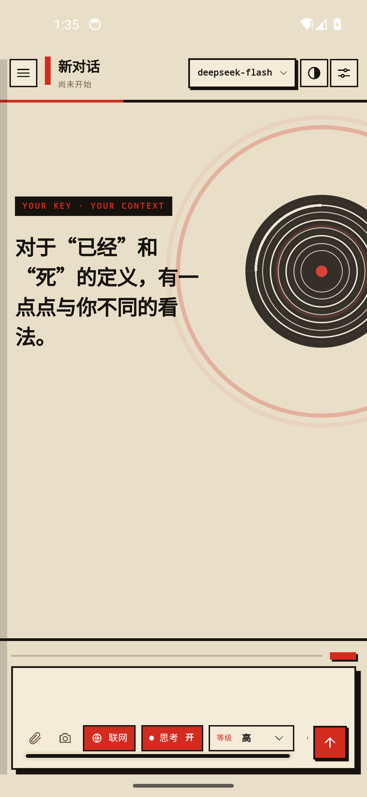

# D&M

本地优先的 AI 对话客户端。Android / Windows / 浏览器，浅色与深色两套模式：

- **浅色模式**：黑色镜头、红色信号，克制、清楚。
- **深色模式**：深海军蓝、翻转的 D、神经网络空腔，松弛、安静。

API Key、对话和设置只保存在本机；没有广告、统计、遥测或第三方分析 SDK。

## 下载

从 GitHub Releases 下载最新 Android APK：

`https://github.com/YOUR_NAME/D-M/releases/latest`

当前公开版本：**1.0.0**  
包名：`com.dm.chat`  
APK SHA-256：`6BA8C731D43FEEC72F95780C527F27D7D1390F99197B2A383DF5E91D957DB072`

> 发布前请把 `YOUR_NAME` 换成你的 GitHub 用户名，并把 APK 上传到 Releases。

## 功能

- 流式对话、思考开关与思考等级
- DeepSeek 及兼容 HTTPS API
- 多层级子会话、选中文字继续追问
- 附件、语音输入、朗读
- 对话一键导入 / 导出，不导出 API Key
- 浅色 / 深色主题，Android 启动图标随主题切换
- 桌面 / 手机响应式界面

## 截图

| 浅色 | 深色 |
| --- | --- |
|  |  |

## 本地运行

需要 Node.js 18+：

```bash
npm install
npm start
```

打开 `http://127.0.0.1:3210`。

Windows 独立版使用 Electron，内置 Chromium；构建产物不提交到仓库。

## Android

APK 是原生 WebView 应用，不需要电脑或局域网：

- 手机直接通过 HTTPS 请求你设置的 API
- Key 存在 Android 应用私有数据里
- 只申请 `INTERNET` 和 `RECORD_AUDIO`
- `allowBackup=false`，拒绝明文 HTTP
- release 签名，target SDK 36

Android 源码在 `android/`。构建使用 JDK 17、Android SDK Platform 36 和 Build Tools 34，通过 `aapt2` / `d8` / `apksigner` 手动打包；具体命令见 `INSTALL.md`。

**签名密钥不提交到仓库**。`android/signing/` 已被 `.gitignore` 忽略。发布者必须自行保管 release keystore。

## 安全与隐私

- [SECURITY.md](SECURITY.md) — 安全审查、残余风险、回环地址限制
- [store/PRIVACY.md](store/PRIVACY.md) — 隐私政策原文
- [privacy.html](privacy.html) — 可部署到 GitHub Pages 的隐私政策页面

不要把 `android/signing/`、`node_modules/`、`.env` 或任何真实 API Key 提交到 GitHub。

## 许可

代码与原创图标采用 [MIT License](LICENSE)。

图形与界面为本项目原创；第三方引用与版权说明见 [NOTICE.md](NOTICE.md)。
